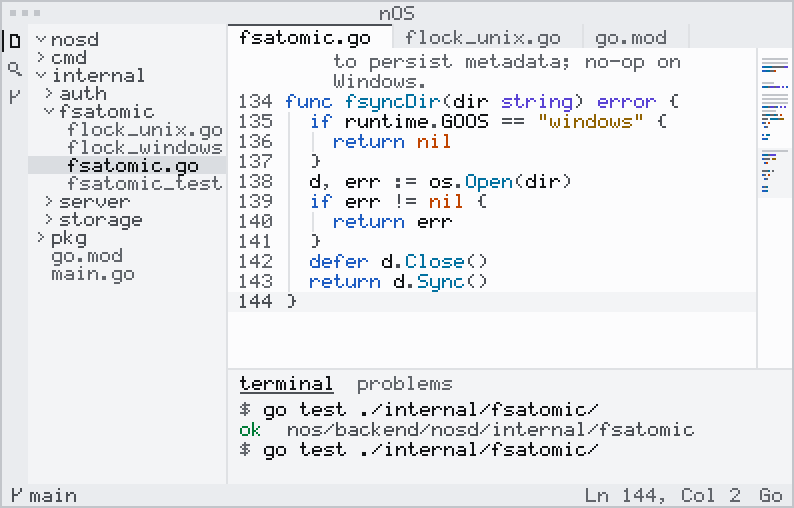

<picture>
  <source media="(prefers-color-scheme: dark)" srcset="https://raw.githubusercontent.com/Nithron/.github/main/profile/assets/editor-dark.png">
  
</picture>

# Nithron

**Build it to be run.**

Nithron is a one-engineer studio in Veurne, Belgium, run by [Thiago Benkendorf](https://github.com/noxhex). Client engineering is the day job. The software and the research are what it builds for itself.

[nithron.com](https://nithron.com) · [ai.nithron.com](https://ai.nithron.com) · [hello@nithron.com](mailto:hello@nithron.com)

## Software

| | | |
|:--|:--|:--|
| **[nOS](https://github.com/Nithron/nOS)** | A NAS operating system you can read: storage, shares, backups and apps from a dashboard on your own network. | Pre-alpha |
| **[Niro](https://github.com/Nithron/Niro)** | A Discord bot for communities, built around moderation and security. | Runs at [niro.nithron.com](https://niro.nithron.com) |
| **[nAI](https://github.com/Nithron-Intelligence/nAI)** | Answers questions from the files on your own hardware and names its source. Built by [Nithron Intelligence](https://github.com/Nithron-Intelligence). | In development |

The products are source-available under the **Nithron Community License v1.0**. That is not open source: each repository carries its LICENSE, NOTICE and trademark policy, so read them before you ship.

## Research

[Nithron Intelligence](https://ai.nithron.com) is the research division. It trains small models for hardware you own, measures them on its own benchmark and publishes the number either way.

## Client work

Backend, data and platform engineering, done by one engineer. The record, with dates, is in the [case studies](https://nithron.com/case-studies/):

- Document search memory from about 1.2 GB to 400 MB, and 20 microservices moved to .NET 6. Aviation, 2025. Independent work alongside Nithron.
- One platform for 270 people on four sites. Manufacturing, 2024 to 2025. Independent work alongside Nithron.
- A migration of 300+ tests planned for two years, done in one week. Enterprise software at OSYON. Before Nithron.

Not taking new projects right now. Still worth a message: [hello@nithron.com](mailto:hello@nithron.com). Replies come from one person.

Nithron, founded by Thiago Benkendorf. Enterprise number 1044.572.115. Veurne, Belgium.
