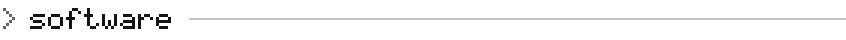
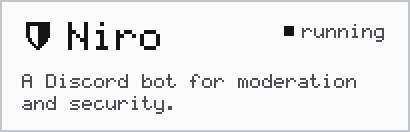
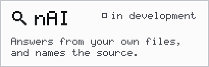
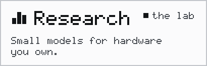
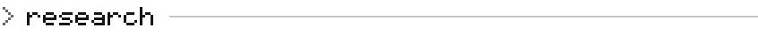
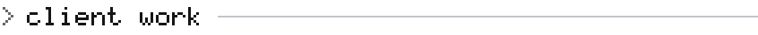

<picture><source media="(prefers-color-scheme: dark)" srcset="https://raw.githubusercontent.com/Nithron/.github/main/profile/assets/hero-nithron-dark.svg"></picture>

<a href="https://nithron.com">nithron.com</a> · <a href="https://ai.nithron.com">ai.nithron.com</a> · <a href="https://github.com/Nithron-Intelligence">Nithron Intelligence on GitHub</a>

Nithron is a one-engineer studio in Veurne, Belgium, run by [Thiago Benkendorf](https://github.com/noxhex). Client engineering is the day job. The software and the research are what it builds for itself.

<picture><source media="(prefers-color-scheme: dark)" srcset="https://raw.githubusercontent.com/Nithron/.github/main/profile/assets/h-software-dark.svg"></picture>

<a href="https://github.com/Nithron/nOS"><picture><source media="(prefers-color-scheme: dark)" srcset="https://raw.githubusercontent.com/Nithron/.github/main/profile/assets/card-nos-dark.svg"></picture></a> <a href="https://github.com/Nithron/Niro"><picture><source media="(prefers-color-scheme: dark)" srcset="https://raw.githubusercontent.com/Nithron/.github/main/profile/assets/card-niro-dark.svg"></picture></a>

<a href="https://github.com/Nithron-Intelligence/nAI"><picture><source media="(prefers-color-scheme: dark)" srcset="https://raw.githubusercontent.com/Nithron/.github/main/profile/assets/card-nai-dark.svg"></picture></a> <a href="https://ai.nithron.com"><picture><source media="(prefers-color-scheme: dark)" srcset="https://raw.githubusercontent.com/Nithron/.github/main/profile/assets/card-lab-dark.svg"></picture></a>

The products are source-available under the **Nithron Community License v1.0**. That is not open source: each repository carries its LICENSE, NOTICE and trademark policy, so read them before you ship.

<picture><source media="(prefers-color-scheme: dark)" srcset="https://raw.githubusercontent.com/Nithron/.github/main/profile/assets/h-research-dark.svg"></picture>

[Nithron Intelligence](https://github.com/Nithron-Intelligence) is the research division. It trains small models for hardware you own, measures them on its own benchmark and publishes the number either way.

<picture><source media="(prefers-color-scheme: dark)" srcset="https://raw.githubusercontent.com/Nithron/.github/main/profile/assets/h-client-work-dark.svg"></picture>

Backend, data and platform engineering, done by one engineer. The record, with dates, is in the [case studies](https://nithron.com/case-studies/).

| Result | Where | When |
|:--|:--|:--|
| Document search memory from about 1.2 GB to 400 MB, and 20 microservices moved to .NET 6 | Aviation | 2025, independent work alongside Nithron |
| One platform for 270 people on four sites | Manufacturing | 2024 to 2025, independent work alongside Nithron |
| A migration of 300+ tests planned for two years, done in one week | Enterprise software, at OSYON | Before Nithron |

<picture><source media="(prefers-color-scheme: dark)" srcset="https://raw.githubusercontent.com/Nithron/.github/main/profile/assets/h-contact-dark.svg"></picture>

Not taking new projects right now. Still worth a message: hello@nithron.com. Replies come from one person.

Nithron, founded by Thiago Benkendorf. Enterprise number 1044.572.115. Veurne, Belgium.
